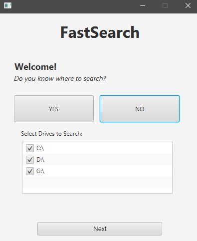

# FastSearch

FastSearch is a high-performance, multi-threaded file search and disk usage explorer for Windows, built with JavaFX.
It indexes the filesystem in parallel, lets you filter the results live, and shows where your disk space goes
with a heat-mapped folder tree.

---

## Features

### Multi-Threaded Indexing
- Each directory is scanned as a separate task on a shared thread pool.
- Live progress indicator with an animated gear and the processed file count.
- Stall detection: if scanning gets stuck, the gear stops and shows the folder it is stuck at.

### Live Filters
Filters can be changed at any time and apply instantly to everything indexed so far:

- **File Name**: partial matching supported.
- **File Types**: allowlist or denylist of extensions.
- **File Size**: minimum and maximum size in MB.
- **Modified Date**: files *before* or *after* a specific date.
- **Protected / System Folder Exclusion**
  (e.g. Windows, Program Files, System32, etc.)

### Sorting Options
Results can be sorted by name, size, modified date or file type, in ascending or descending order.

### Rich Results View
- 3-column, virtualized list (smooth even with millions of results).
- File icon, name, size and last modified date for each entry.
- **Open** button: opens the file in Windows Explorer with selection.
- **Delete** button: deletes the file after a confirmation dialog.

### Folder Tree View
- Flowgraph-style folder tree with zoom and pan.
- Heat map from yellow to red, relative to the capacity of the volume.
- Per-drive trees with volume info; left click expands/collapses, right click opens in Explorer.

---

## Installation & Usage

## Version 2 – Changelog

### Highlights
- **Everything is indexed.** The search no longer filters while scanning: all files are indexed,
  and filters are applied on top of the index. The wizard settings are only the *initial* filter.
- **Live filtering.** Change the name, file types or min/max size at any time. The new filter is
  applied instantly to everything indexed so far, and to new files as they are discovered.
- **Virtualized results.** Only the rows that fit on screen (plus one partial row) are rendered,
  so millions of results stay smooth.
- **Folder tree view (new).** Switch between *List* and *Tree* at any time.

### Results list
- 3-column layout, filled top to bottom, column by column; scroll by column with the mouse wheel
  or the scrollbar.
- Compact icon buttons (Open / Delete) in the top-right corner of every entry; long file names
  shrink with an ellipsis instead of hiding the buttons.
- Full path in a tooltip. File icons are cached.
- Fixed sort direction toggle (ascending / descending).

### Tree view
- Flowgraph-style folder tree with right-angle ("Manhattan") arrows.
- Zoom (mouse wheel, centered on the cursor) and pan (drag).
- Left click expands / collapses a folder, right click opens it in Explorer.
- Folders are expanded by default, largest first, up to a node limit to keep the graph readable.
- Every folder shows its total size (KB / MB / GB), aggregated bottom-up through the whole subtree.
- **Heat map:** folders and arrows are colored from yellow (light) to red (heavy), relative to
  the total capacity of the volume, so large hidden branches stand out immediately.
- One tree per selected drive, side by side. Each root shows the volume info
  (file system, free / total space). Folders mounted from another volume are marked with ⛁
  and are not counted into their parent's size.

### Progress & stability
- Animated ASCII gear tied to the processed file count.
- Stall detection: if there is no progress for 5 seconds, the gear stops and shows the last
  folder being scanned.
- Reworked crawler: one task per directory on a shared thread pool, reliable completion
  detection (no more timeout workaround), thread-safe index, daemon threads.
- Junctions and symbolic links are no longer followed, which prevents infinite loops.
- Reduced memory usage: results no longer hold `File` objects, paths are built on demand.
- Fixed icon lookup for files without an extension, and protected folders are now matched
  correctly (the folder itself, not only its children).

### Notes
- The search window is now resizable (default 1100×700).
- The wizard and options screens are unchanged.

